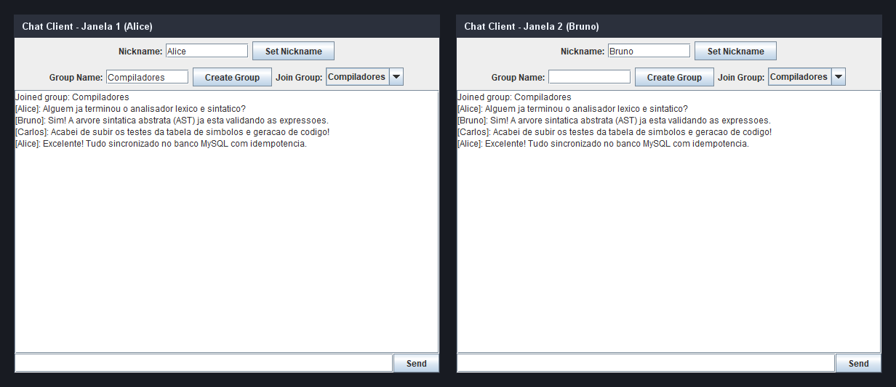
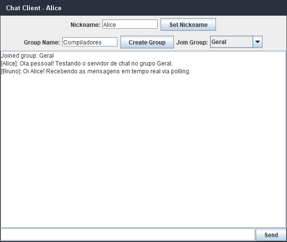
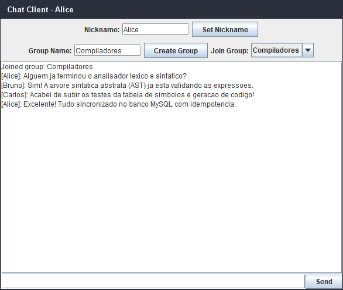

# Chatgroup

Sistema cliente-servidor de chat em grupo com persistencia em banco de dados relacional (MySQL), comunicacao via API HTTP REST, controle de idempotencia de mensagens e interface grafica desktop em Java Swing (com suporte a execucao via navegador utilizando noVNC em container Docker).

Projeto desenvolvido para a disciplina de Compiladores da faculdade.

---

## Sumario

1. [Visao Geral e Arquitetura](#visao-geral-e-arquitetura)
2. [Demonstracao e Capturas de Tela](#demonstracao-e-capturas-de-tela)
3. [Tecnologias Utilizadas](#tecnologias-utilizadas)
4. [Estrutura do Projeto](#estrutura-do-projeto)
5. [Execucao com Docker Compose](#execucao-com-docker-compose)
6. [Execucao Local com Maven](#execucao-local-com-maven)
7. [Endpoints da API REST](#endpoints-da-api-rest)
8. [Modelo de Dados e Idempotencia](#modelo-de-dados-e-idempotencia)

---

## Visao Geral e Arquitetura

O sistema e dividido em tres componentes principais orquestrados via Docker Compose:

- **Banco de Dados (`mysql`)**: Instancia MySQL 8.0 responsavel por armazenar os grupos (`grupos`) e o historico de mensagens (`messages`), garantindo integridade referencial e desduplicacao por chave de idempotencia (`idem_key`).
- **Servidor HTTP (`chat-server`)**: Servidor implementado em Java 21 sobre `com.sun.net.httpserver.HttpServer`, com pool de threads fixo, serializacao JSON via Gson e acesso a dados via JDBC com `PreparedStatement`.
- **Cliente Grafico (`chatclient`)**: Aplicacao desktop em Java Swing (`JFrame`) que realiza polling incremental baseado no timestamp do servidor (`timestamp_server`), retentativas automaticas com backoff em caso de falha de rede e desduplicacao local de mensagens. No ambiente Docker, a interface Swing e renderizada em um display virtual X11 (`Xvfb` + `Fluxbox`) e disponibilizada via WebSockets/noVNC na porta `6080`.

---

## Demonstracao e Capturas de Tela

### 1. Multiplos Clientes Simultaneos em Tempo Real

Duas instancias independentes do cliente (`Alice` e `Bruno`) conectadas simultaneamente ao grupo `Compiladores`, trocando mensagens entre si e recebendo atualizacoes de um terceiro participante (`Carlos`):



### 2. Interacao no Grupo Geral

Definicao de apelido (`Nickname`), criacao de novo grupo e troca de mensagens iniciais no grupo padrao `Geral`:



### 3. Historico e Sincronizacao por Grupo

Alternancia entre grupos pelo seletor (`Join Group`) com carregamento automatico do historico persistido no MySQL:



---

## Tecnologias Utilizadas

- **Linguagem**: Java 21
- **Gerenciador de Dependencias e Build**: Apache Maven
- **Interface Grafica**: Java Swing / AWT
- **Serializacao JSON**: Google Gson 2.10.1
- **Banco de Dados**: MySQL 8.0 (JDBC `mysql-connector-j` 8.0.33)
- **Containerizacao e Exibicao Web**: Docker, Docker Compose, Xvfb, Fluxbox, x11vnc e noVNC

---

## Estrutura do Projeto

```text
Chatgroup/
├── chat-server/
│   ├── Dockerfile
│   ├── pom.xml
│   └── src/main/java/com/chatserver/
│       ├── DB.java
│       ├── Handlers.java
│       └── Server.java
├── chatclient/
│   ├── Dockerfile
│   ├── pom.xml
│   └── src/main/java/com/chatclient/
│       ├── ClientGUI.java
│       └── HttpClientUtil.java
├── database/
│   └── init.sql
├── docs/
│   └── images/
│       ├── chat-compiladores.png
│       ├── chat-geral.png
│       └── chat-multi-client.png
└── docker-compose.yml
```

---

## Execucao com Docker Compose

O arquivo `docker-compose.yml` utiliza `healthcheck` e `depends_on` (`condition: service_healthy`) para garantir a ordem exata de inicializacao dos servicos:

1. **`mysql`**: Inicia o MySQL 8.0, executa o script `database/init.sql` e aguarda o banco responder ao `mysqladmin ping`.
2. **`chat-server`**: Inicia apenas apos o MySQL estar saudavel, expondo a API REST na porta `8000`.
3. **`chatclient`**: Inicia apenas apos a porta `8000` do servidor estar ativa, disponibilizando a interface Java Swing no navegador via noVNC na porta `6080`.

### Passos para iniciar

1. Certifique-se de que o Docker e o Docker Compose estao em execucao.
2. Na raiz do repositorio, execute:

```bash
docker compose up -d --build
```

3. Acesse a interface grafica Java Swing diretamente no navegador:

```text
http://localhost:6080/vnc.html?autoconnect=true
```

4. A API REST do servidor estara disponivel em:

```text
http://localhost:8000
```

5. Para encerrar os containers:

```bash
docker compose down
```

---

## Execucao Local com Maven

Caso deseje executar o servidor ou abrir multiplas janelas nativas do cliente diretamente no sistema operacional:

1. Com o banco MySQL ativo (via Docker ou instalacao local na porta `3306`), compile e inicie o servidor:

```bash
cd chat-server
mvn clean compile exec:java -Dexec.mainClass="com.chatserver.Server"
```

2. Em outro terminal, compile e inicie quantas instancias desejar do cliente Swing:

```bash
cd chatclient
mvn clean compile exec:java -Dexec.mainClass="com.chatclient.ClientGUI"
```

### Variaveis de Ambiente Suportadas

| Componente | Variavel | Valor Padrao | Descricao |
| :--- | :--- | :--- | :--- |
| `chat-server` | `DB_URL` | `jdbc:mysql://localhost:3306/chatdb?useSSL=false&allowPublicKeyRetrieval=true&serverTimezone=UTC` | URL de conexao JDBC do MySQL |
| `chat-server` | `DB_USER` | `root` | Usuario do banco de dados |
| `chat-server` | `DB_PASS` | `senha` | Senha do banco de dados |
| `chatclient` | `SERVER_URL` | `http://localhost:8000` | URL base do servidor HTTP |

---

## Endpoints da API REST

### 1. Definir Apelido

- **Metodo / Rota**: `POST /nick`
- **Corpo da Requisicao**:

```json
{
  "name": "Alice"
}
```

- **Resposta (`200 OK`)**:

```json
{
  "status": "ok"
}
```

### 2. Criar Grupo

- **Metodo / Rota**: `POST /grupos` (ou `POST /groups`)
- **Corpo da Requisicao**:

```json
{
  "name": "Compiladores"
}
```

- **Resposta (`200 OK`)**:

```json
{
  "id": 2,
  "name": "Compiladores"
}
```

### 3. Listar Grupos

- **Metodo / Rota**: `GET /grupos` (ou `GET /groups`)
- **Resposta (`200 OK`)**:

```json
[
  {
    "id": 1,
    "name": "Geral"
  },
  {
    "id": 2,
    "name": "Compiladores"
  }
]
```

### 4. Enviar Mensagem para um Grupo

- **Metodo / Rota**: `POST /grupos/{id}/messages` (ou `POST /groups/{id}/messages`)
- **Corpo da Requisicao**:

```json
{
  "idemKey": "550e8400-e29b-41d4-a716-446655440000",
  "nickname": "Alice",
  "text": "Alguem ja terminou o analisador lexico e sintatico?",
  "timestamp_client": 1732230000000
}
```

- **Resposta (`200 OK`)**:

```json
{
  "inserted": true
}
```

### 5. Buscar Mensagens de um Grupo (Polling Incremental)

- **Metodo / Rota**: `GET /grupos/{id}/messages?since={timestamp_ms}&limit={max}`
- **Resposta (`200 OK`)**:

```json
[
  {
    "nickname": "Alice",
    "text": "Alguem ja terminou o analisador lexico e sintatico?",
    "timestamp_client": 1732230000000,
    "timestamp_server": 1732230000512
  }
]
```

---

## Modelo de Dados e Idempotencia

O esquema relacional definido em `database/init.sql` utiliza duas tabelas principais:

- **`grupos`**: Armazena `id` (`BIGINT AUTO_INCREMENT PRIMARY KEY`), `name` (`VARCHAR(255) NOT NULL UNIQUE`) e `created_at`.
- **`messages`**: Armazena `id`, `grupo_id` (chave estrangeira para `grupos.id` com `ON DELETE CASCADE`), `idem_key`, `text`, `nickname`, `timestamp_client` e `timestamp_server`.

A restricao `UNIQUE KEY unique_message (grupo_id, idem_key)` garante que, mesmo que o cliente realize retentativas automaticas de envio por instabilidade de rede, uma mesma mensagem nunca seja duplicada no banco de dados.
